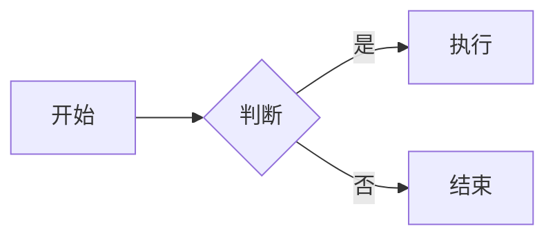
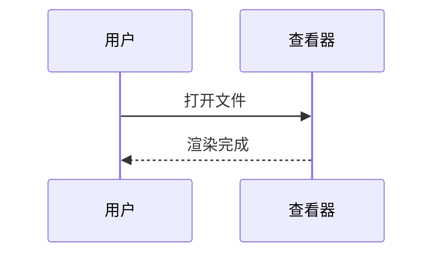

# 公式与图表

> 预期：行内/独立公式排版正确；两张图按皮肤配色渲染；
> 未知图类型的那个块保留源码（日志里有 mermaid-error，属预期）。

行内公式 $E = mc^2$，行内希腊字母 $\alpha + \beta$。

$$
\int_0^1 x^2 dx = \frac{1}{3}
$$

$$\begin{pmatrix} a & b \\ c & d \end{pmatrix}$$





```mermaid
unknownDiagram
  x --> y
```

| 符号 | 公式 |
|---|---|
| 欧拉 | $e^{i\pi}+1=0$ |
| 积分 | $\sum_{i=1}^{n} i$ |
