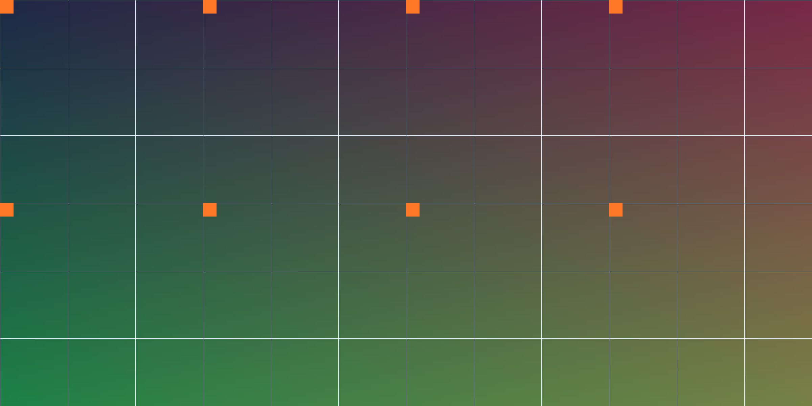
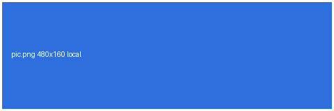
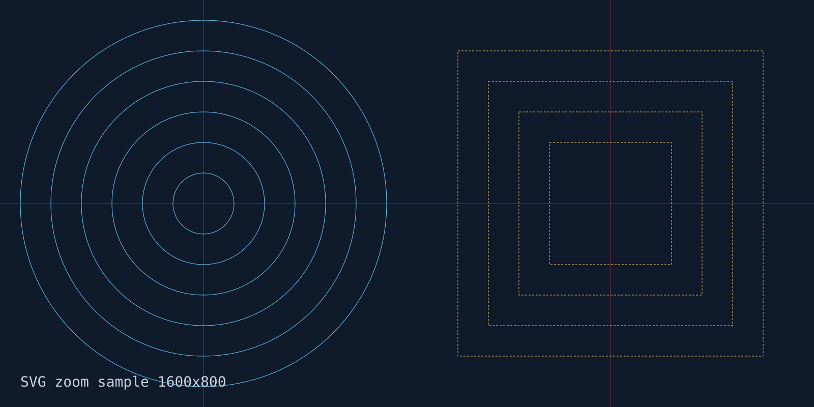

# 图片点击放大样例

用来验收图片的两条新交互：左键点图开页内遮罩放大（滚轮以光标为中心缩放、按住拖动平移、
双击在 1:1 与适应窗口之间切换、Esc 或点背景关闭）；右键图出图片动作区
（「放大查看」+「打开方式」子菜单）。逐项核对手册见 CHECK.md 第十六节。

## 1. 本地大图（遮罩初始为缩小适应）

图比窗口大：左键后应整张完整显示在黑底遮罩里。滚轮往上放大时缩放中心应始终
落在光标下；放大后按住拖动，图像边缘不许拖出视口外露缝；双击回 1:1 后网格线
应当锐利；Esc 与点背景都能关闭，点图片本身不关闭。

## 2. 本地小图（遮罩初始为放大适应）

图比窗口小：遮罩里按 contain 口径放大塞满。双击应切回 1:1（此时图片比窗口小，
固定居中、拖不动）。

## 3. 矢量图

SVG 同样支持放大与「打开方式」；1:1 与放大后发丝线和同心圆应保持锐利。

## 4. 链接内的图片（左键跟链接，放大走右键）

左键点这张缩略图必须跟随链接（弹外部链接确认），不开遮罩；
想放大时右键它，菜单里照样有「放大查看」与「打开方式」。

## 5. data URI 图

左键可放大；右键只有全局菜单（data: 没有磁盘路径，「打开方式」无从谈起）。

## 6. 网络图片（确认后才可动手）

确认加载前右键只有全局菜单；确认加载后左键可放大、右键只有「放大查看」，
没有「打开方式」——插件不把远程图落盘。

## 7. 找不到的本地图片（右键应回退全局菜单）

加载失败的破图右键时不应出现图片动作区。
