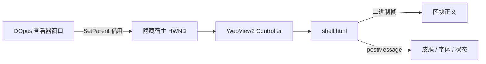
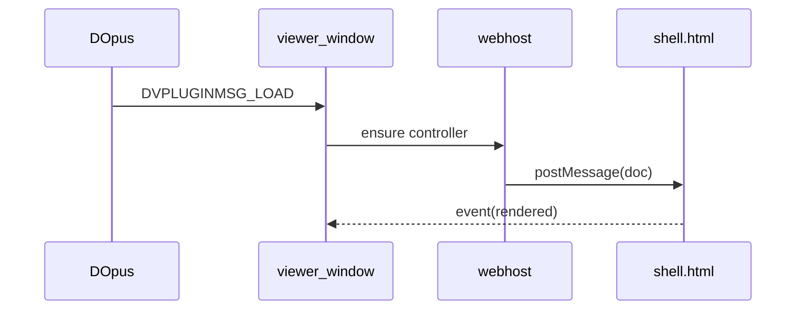

# 公式与图表

Mermaid 只在本文出现 ```mermaid 时才会去拉 `mermaid.js`（5.0 MiB）。

## 流程图



## 时序图



## 行内公式

能量与动量：$E^2 = (pc)^2 + (m_0 c^2)^2$，当 $v \ll c$ 时退化为 $E \approx m_0c^2 + \frac{1}{2}m_0v^2$。

## 独立公式

$$
\mathrm{Fenwick}(i) = \sum_{k=i-\mathrm{lowbit}(i)+1}^{i} w_k
$$

$$
T(n) = \begin{cases} \Theta(1) & n \le 64 \\ 2T(n/2) + \Theta(n) & n > 64 \end{cases}
$$

## 未知图类型（应降级为源码块）

```mermaid
nonsenseDiagram
  X --> Y
```
