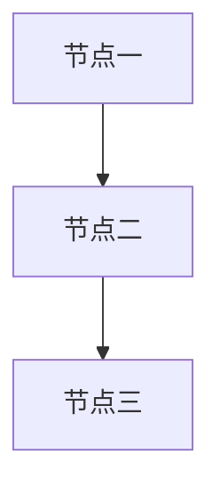
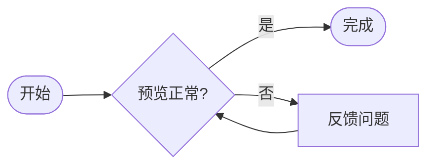

# 链接确认弹窗测试

> 预期：**每一条**外部链接点击后都先弹确认框，显示完整链接；"打开"按钮倒数 3 秒后才能点；默认焦点在"取消"，Esc 或点取消后什么都不发生。

## 1. 正常链接

- [https 普通链接](https://example.com/)
- [https 带路径与参数](https://example.com/search?q=md%20viewer&lang=zh)
- [mailto 链接](mailto:someone@example.com)

## 2. 危险链接（重点）

> 注意：`file:` / `javascript:` 的 **markdown 链接语法**会被 markdown-it 的安全过滤拦下，只渲染成纯文本（不是链接、点不了），这是预期行为。绕过过滤的口子在下一节的**内联 HTML**。

- [file 指向 exe](file:///C:/Windows/System32/calc.exe)
- [file 指向 bat](file:///C:/Windows/System32/whoami.exe)
- [UNC 路径](file://localhost/C:/Windows/System32/calc.exe)

### 内联 HTML 夹带 data-external（这两条才是重点）

<a data-external="file:///C:/Windows/System32/calc.exe">点我启动计算器（内联 HTML）</a>

<a data-external="C:\Windows\System32\calc.exe">点我启动计算器（裸路径）</a>

### 裸 scheme（同样会被 markdown-it 拦掉，渲染成纯文本属正常）

- [javascript: 伪协议](javascript:alert(1))

## 3. 带百分号编码的长链接（测换行与复制）

- [超长 URL](https://example.com/very/long/path/%E4%B8%AD%E6%96%87/%E6%B5%8B%E8%AF%95?token=abcdefghijklmnopqrstuvwxyz0123456789abcdefghijklmnopqrstuvwxyz0123456789&next=%2Fdeep%2Fdeeper%2Fdeepest%2Fpath%2Fsegment%2Fafter%2Fsegment%2Funtil%2Fit%2Fwraps)

## 4. 网络图片（测加载确认，与链接确认相互独立）


## 5. mermaid：init 指令夹带 url()

下面这张图渲染成功后，检查画面正常（有字有框），且不应发出任何远程请求（图表里那一行 url 已被剥掉）：



## 6. mermaid 普通图（回归）



## 7. 渲染回归小项

| 表格 | 列二 |
| --- | --- |
| 单元格 | 含 **加粗** 与 `代码` |

- [ ] 任务列表项
- 普通列表项

> 引用块

```python
def hello():
    print("代码高亮")
```

脚注测试[^1]

[^1]: 脚注内容，点角标应跳到文末。
